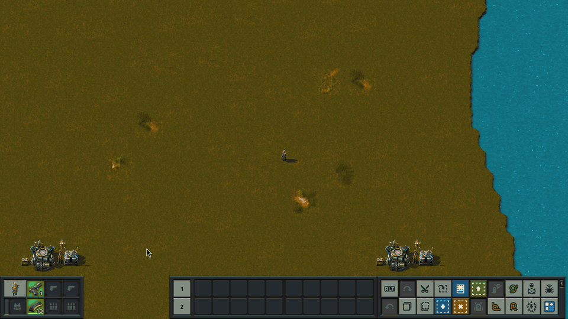
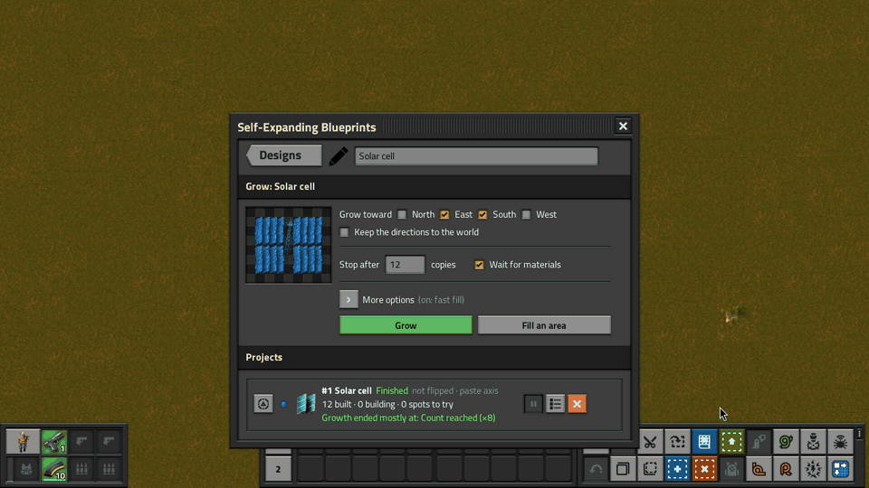
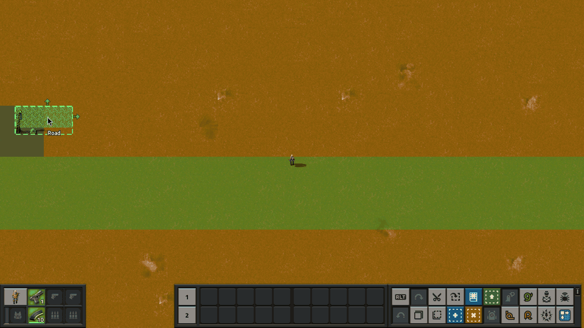
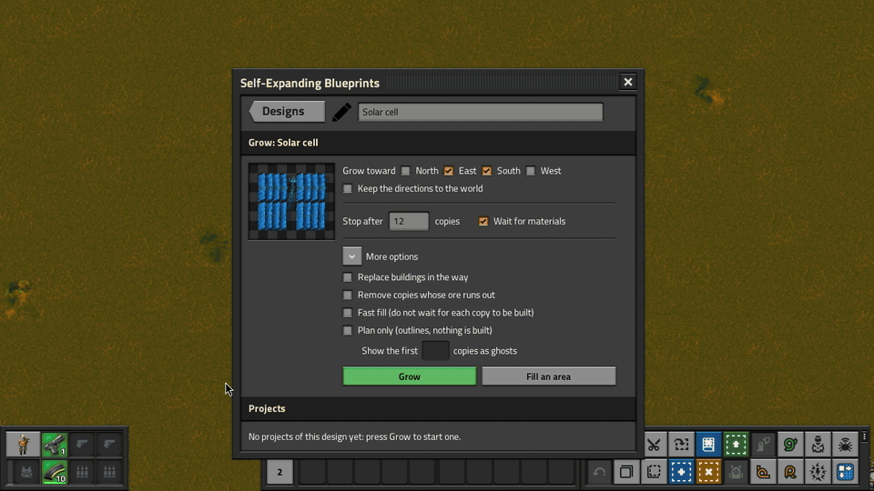
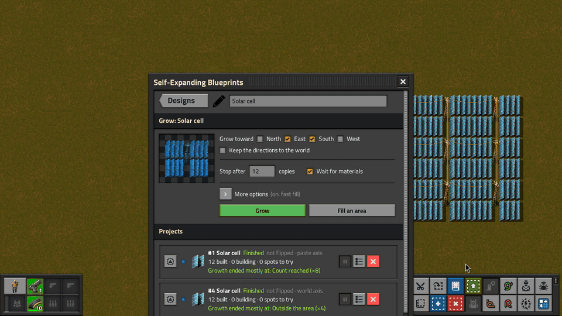
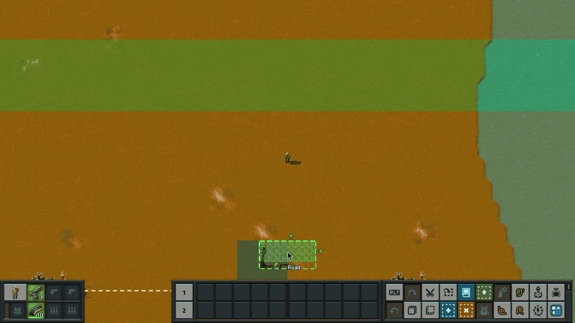
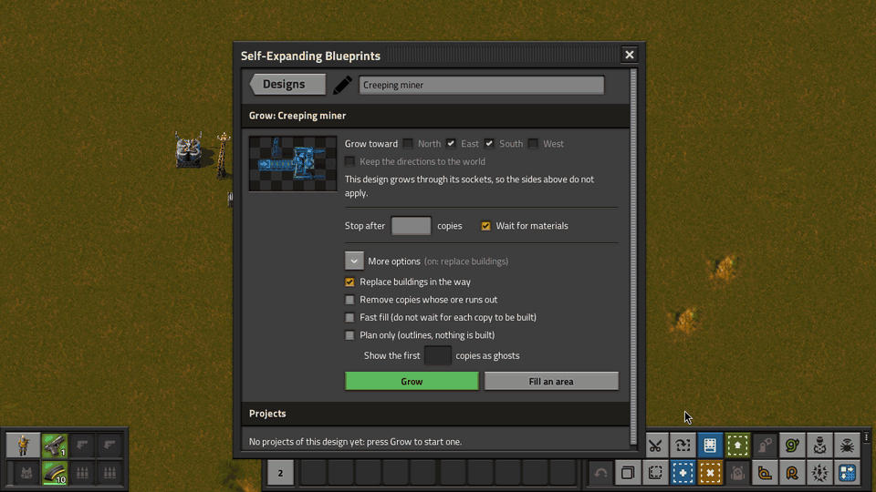

# Self-Expanding Blueprints

**Grow a factory from your own blueprints.**

Register a blueprint as a design, press Grow and click the map, and the mod keeps stamping copies of it: it picks the next spot, checks it, stamps it whole, waits for the construction robots, then opens the next spots. Growth stops at water, cliffs, other buildings, uncharted land or the count you set (4 copies unless you change it). Every copy is remembered: it reports when its robots are done, and you can remove exactly that copy and nothing next to it.



Recursive Blueprints created this genre: a chest that stamps blueprints on circuit command, so a factory can build itself. Self-Expanding Blueprints reimagines the idea from scratch, with recursion drawn into the blueprints themselves and every stamp tracked as an instance. It is written for Factorio 2.1, and everything is keyed by force and surface, so every Multi-Team Support team grows its own factory.

## Status

Version 0.2.0, the first release. Most of [DESIGN.md](DESIGN.md) is in: growth with sockets, plugs, probes, ore sensors, Keep clear tiles and pools; turned and flipped pastes; plans before building; updates in place and research upgrades; the blueprint builder for circuits; space platforms. The remote interface is still a draft, and per-copy parameters are open (section 8). Every Multi-Team Support team has its own designs, and a released team's records are dropped.

A headless suite runs in base and Space Age, and a multiplayer join test runs a real client against a headless server. The window, growing, plans and the copies panel have been played in a game client. Ore sensors, probes, pools, updates, circuit requests and space platforms have had less play in a real game; [dev/PLAYTEST.md](dev/PLAYTEST.md) lists what has been seen in a client.

## Playing

Open the window with the shortcut-bar button or **SHIFT + ALT + G**. Its front page lists your team's designs, with the add button and the Draw row above the list. It reopens on the page you left.

1. **Add a design.** Hold a blueprint (from your inventory or your blueprint library); the add button names it ("Add “Solar cell” as a design"). A book adds every blueprint in it, and a labelled book also becomes a pool. A big book takes a moment: its designs come in one after another, each with its line in chat. A blueprint with the name of an existing design becomes its next version. Hover a design to see a picture of it. Each row also has a slot for a research that updates the design's copies when your team finishes it, a button that replaces the design with the blueprint in your hand, and a delete button. The book button above the list takes every design as one blueprint book, to keep or to add in another save.
2. **Open its page.** Click the design's name ("Click a design to grow it and see its projects"). The page has the grow options and, below them, only that design's projects. **Designs** takes you back. The design's name at the top is a text field: type a new one and press Enter to rename it everywhere (sockets drawn with the old name still find it).
3. **Choose how it grows.** Tick the directions to grow toward (a design with socket arrows grows only through them) and set **Stop after**: 4 copies unless you change it, empty means no limit. **Wait for materials** is on by default. **More options** is folded away (folded, it names the ones that are on): **Replace buildings in the way** superforces copies over your own buildings and, on the floor they need, over water, lava and space, and over the copy it grows from (a Ctrl + Shift click with the design does the same for one project), **Remove copies whose ore runs out** retires dry copies, **Fast fill** places copies without waiting for each one to be built, and **Plan only** lays the project out as outlines first (5 copies unless you set another number, optionally with its first few copies as look-only ghosts).
4. **Press Grow.** The design is in your hand (the window stays open; drag it aside, or close it with E), its ghosts following the pointer inside a dashed frame. Turn it (R) or flip it as any blueprint: every copy, and the directions it grows toward, turn and flip with it (tick **Keep the directions to the world** to keep north up). A flipped paste grows the design's mirror image, listed under the same design and marked "flipped"; a design with rails, signals, train stops, locomotives or wagons cannot be flipped. **Click** the map: the first copy grows exactly where its ghosts showed, and the design comes back into your hand, turned and flipped as you had it: every click starts another project, so you can grow, grow, grow along a row. Q empties your hand. Holding the button down starts one project, not one per moment held. While you hold it (or the area tool), every copy of your team around you is outlined, so you can see where a paste would meet copies already there; a copy whose buildings and ghosts were all removed, by hand or otherwise, is forgotten and frees its spot. A paste over copies already there is refused, naming them and flashing them on the map. Works from map view and remote view; nothing goes into a chest. The first copy goes down even where no robots reach yet; later copies wait for robots.
5. **Or fill an area.** **Fill an area** gives you the area tool: **drag** a rectangle and copies fill it from the corner you started at toward where you let go, and never leave it; only a **Stop after** count you set yourself cuts a fill short. A plain click with the tool grows from that tile. **Right-drag** over copies to retire them: their robots remove exactly what each copy built. **Shift + right-drag** tries the blocked spots under the drag again.
6. **Watch it.** Each project of the design has a panel on its page: a status light, what it waits for or why it stopped, its counts, and a line saying whether the paste was flipped and whether it keeps the world axis or the paste axis. Hover it for its recent history and to see its copies outlined on the map. Pause, resume or stop it, show it on the map (left-click: where it is growing now; right-click: all of it; the window stays open), update its older copies, or list the copies that need a look. A finished plan has a green check to grow it for real. A project that ends without building anything turns red and says why and where, and whoever started it gets a chat line with a map link.









On the map, copies still building show an outline and how many ghosts are left, plus a faint arrow and a dashed outline for each copy that comes next; the next open sockets show as arrows; a socket that closed at water, a cliff or a building shows a red cross with the reason. Such a spot is tried again on its own once something there is mined or destroyed, landfilled or charted, and a finished project grows on from it; press the project's Retry button, or Shift + right-drag the area tool over the crosses, to try them again by hand. A project you start that builds nothing is not kept: why shows at the cursor and in chat. Finished projects fold away under a "Show N finished" button, and the bar above the list pauses, resumes, retries, clears the finished or stops every project of the design at once. Stopping a project takes all of its marks off the map.

The Tips and Tricks screen has a Self-Expanding Blueprints section: one entry per use case, each with a simulation that runs the mod.

### Drawing growth into a design

A plain blueprint tiles in the chosen directions, stepping by its snap grid if it has one, else by its size. With absolute snapping on, every copy also sits on the blueprint's world grid, exactly where you would paste it by hand. For anything smarter, draw markers into the design before you blueprint it. The Draw row on the window's front page hands them out (sockets, plugs, probes and ports come 20 at a time; the ore sensor and Keep clear are tools), and the question mark above it opens "How growing works", a window with a picture for each marker that you can keep open beside your work:

- A **socket** goes on the first tile outside the design, pointing away from it: the next copy is built there, facing this way. Its description (the combinator description field) names the design to attach, or a labelled book (a pool: the first of its designs that fits); leave it empty to grow the same design again.
- A **plug** (optional) goes on the design's own edge, pointing in: when a copy is built at a socket, this tile lands on the socket. A design without one attaches by the middle of its back edge, unturned. A design may have several plugs: number each by setting a signal in it (its value is the number), and a socket with the same number uses that plug, so a row can hang off a trunk by one plug and grow sideways through its own sockets by another. A socket without a number uses the plug without one; a numbered socket whose child has no such plug closes as "No plug with this socket's number".
- **Sockets and sides together.** A design with sockets grows through them; on the Grow page the sides they point to are ticked for you, and you can tick other sides to grow plain copies that way too.
- An **ore sensor** makes copies wait for their ore: a copy grows on only once no ore is left where the sensor looks (on a drill, the drill's area; with its signal R, a square 2R + 1 tiles wide). Its button gives you a tool: click a tile for one sensor, drag for one on every tile (up to 64 x 64 tiles at once), right-click or right-drag takes them off. Tick **Remove copies whose ore runs out** (under More options) and dry copies are removed.
- **A miner that moves on.** A socket can sit on its design's own ground and name another design. With **Remove copies whose ore runs out** ticked, that socket waits until robots have removed the mined-out copy, then builds its design where the copy stood. Two designs make a creeping miner: a head (a drill with an ore sensor, a socket past its edge naming the head and one on the drill naming the belt piece) and a belt piece (belts and a pole). Each head moves on once its ore is gone and the belt line grows behind it, even on maps where nothing but miners may stand on ore. Without the option, such a socket closes as "Would overlap the copy it grows from".
- **One blueprint that creeps.** Three belts and a pole behind a drill, an ore sensor on the drill, a plug at the belt end and a socket on the drill's first column pointing away, naming the design itself. Grow it with **Replace buildings in the way** ticked. Once a drill's ore is gone, the next copy goes down one drill further on: its belts and pole replace the old drill, its drill goes on fresh ore, and every copy keeps its belts and pole, so the line stays whole.
- A **probe** says what must be under its tile before a copy is built there: some ore, the ores its signals name, water, or with the signal "deny" the opposite.
- A **port** on a combinator makes it each copy's mailbox for the blueprint builder.
- **Keep clear** marks a tile your build needs empty, inside it or past its edge: copies keep off it, trees and rocks there are cleared, and a building there stops the copy (or is removed, with Replace buildings in the way). Its button gives you a tool that works like the ore sensor's but skips tiles under your buildings; the marker looks like red corner brackets around a red cross. Negative Space's plain marker in a design works the same way, and its automatic ones around belts and pipes are left out.

To change a design, blueprint a built copy: the copies under your selection put their markers back into the blueprint, settings and socket names included. Paste a blueprint with markers by hand and its markers are placed with it, ready to edit and blueprint again; a marker you place as a ghost (in remote view, or without one in hand) is placed for real at once.

A design with socket arrows grows only through them. Two designs that name each other alternate; a socket pointing south on a design whose entry faces east turns its child a quarter turn.





### Rules and gates

- **All or nothing.** A copy goes down whole or not at all. Trees and rocks are marked for deconstruction, and so are cliffs under the copy once your team has researched cliff explosives (the copy then waits for the explosives); water (lava, the oil and ammonia oceans and space too), cliffs, other buildings, a drill with no ore under it, or an uncharted chunk close that socket and say so. A design that lays its own floor there crosses it. With **Replace buildings in the way**, your own buildings in a copy's way are marked for removal and the copy is built anyway, and a copy on water, lava or space is built on the floor it needs (landfill, foundation, ice platform) once your team can make it, which it waits for like any material.
- **Wait for materials.** With the gate on (the default), the next copy waits until the construction networks reaching it hold everything it costs between them. A player's personal roboport counts only where no roboport network reaches, so standing next to a project with your own robots never changes what it waits for. A spot no construction robots reach waits on its own while growth carries on elsewhere, and is tried again every ten seconds, so it continues once your coverage arrives.
- **Growth runs as fast as the robots.** A copy's sockets open only once it is complete, and at most two copies per project build at once. **Fast fill** opens them as soon as a copy is placed and builds up to eight at once.

### Circuits

The **blueprint builder** (unlocked with the circuit network) takes requests on its input: a verb signal whose value is a request number, with its inputs. It answers *Request accepted* with that number, then *Request done*, or *Request failed* with a named error. Verbs: Stamp (or a grid of copies), Grow (its status and the next copy's materials stay on the output; Pause and Stop control it), Remove, Clear, Sense, Find, Capture (up to 64 x 64 tiles), Upgrade, and Read and Write a copy's port. Stamp, Grow and Find work on land your team has charted; beyond it they answer *Error: uncharted* (a map setting lets a server allow any generated land). Stop on the input ends whatever request is running. Open a builder for every signal it understands.

### Server admins

Map settings cap what each team may ask of the server, and how much of the server the mod may use in all.

- Per team: projects (no limit), plans (3), designs (no limit), parts per design (5,000), blueprint builders (50) and copies in flight (100). Zero means no limit; for designs it means the library's own ceiling of 30,000.
- Size: a design may draw at most 64 sockets and have at most 1,000 electric poles (a pole's ghost wires itself to every pole in reach, so a carpet of them costs more the bigger it is), and a book may hold at most 1,000 blueprints and books, counting the books inside, with 250,000 parts in all. Bigger ones are refused with a message. The size limits apply when a design is registered, so one registered before an admin lowered them keeps working.
- Server time: each team's work is charged to its own share (500 µs per tick by default), and the whole server's work is capped too (4,000 µs per tick), taken in turns. The work runs every sixth tick, so that tick can take about six times the cap. A team that has used up its share waits while the others carry on, so no team can slow the game for the others for long.
- Not bounded: one piece of work still runs in a single tick and can make that tick long, after which the team waits. Registering a design at the 5,000-part limit took 0.62 to 0.96 s on a heavily loaded machine.
- Also: builders keep to charted land unless a map setting allows any generated land. One setting keeps a share of the construction robots idle for a team's own building. Another lets AI Agent Bridge's agent grow, pause, resume and stop a team's projects when asked in chat (off by default; its read tools are always there). The remote interface can give one team its own values (`set_limits`). A "Seed only" challenge scenario starts a team with no hands at all.

## How it works

- Every stamp is calibrated, not computed: a design's copy is stamped once per direction on a hidden lab surface to measure where it lands ([ADR-0002](docs/adr/0002-stamps-land-by-calibrating-a-stamping-copy.md)).
- Every footprint is pre-checked entity by entity before the stamp, and a stamp that still comes out short is rolled back ([ADR-0003](docs/adr/0003-stamps-are-all-or-nothing-through-a-pre-check-and-a-rollback.md)).
- Every ghost is tagged with its instance; completion is decided by recounting, never by a counter ([ADR-0004](docs/adr/0004-completion-comes-from-tags-and-recounts.md)).
- No unconditional `on_tick`: engine events and one due-tick queue drive everything ([ADR-0005](docs/adr/0005-one-due-tick-queue-armed-from-storage.md)).

## For mod authors

The remote interface `self-expanding-blueprints` ships as a draft ([ADR-0007](docs/adr/0007-the-remote-interface-ships-early-as-a-draft.md)): `register_design` (blueprints and books), `list_designs`, `list_pools`, `export_library`, `stamp`, `remove_instance`, `get_instance`, `update_instance`, `start_project` (with rules, order and dry runs), `get_project` (status and history), `pause_project`, `resume_project`, `stop_project`, `retry_project`, `update_project`, `build_project`, `clear` (deconstruct an area), `set_limits`, `get_limits` and `clear_limits` (one team's own values for the map's limits), `set_upgrade_research`, `get_event_id`, and tools for AI Agent Bridge (read tools, plus write tools when an admin allows them). Custom events: `on_instance_completed`, `on_instance_blocked`, `on_instance_stalled`, `on_instance_retired`, `on_project_finished`, `on_materials_missing`. Resolve event ids with `get_event_id` in `on_init` and `on_load`; never store them. Parameters, return values and event payloads are in [docs/remote-interface.md](docs/remote-interface.md). Names and shapes may change before v1.

## Credit

Self-Expanding Blueprints is not a clone of anything: it is a full rewrite with its own design and its own way of playing, and no code is reused. Some ideas were borrowed, with thanks. Recursive Blueprints (Doc, justarandomgeek, DaveMcW) created the genre, and Recursive Blueprints+ (FoxLBA) carried it to Factorio 2.1 with a full command set. Ideas from other mods, with thanks: Simple Recursive Blueprints (Qweasd123tg) for the direction-marker arrow and its headless rotation tests, PersistantBlueprints (mrvn), blueprint-deconstruction-markers (Elwin) and Negative Space (Rycieos) for markers whose ghosts vanish on sight, Construction Probe (Eketek), and AutoDeconstruct (mindmix).

## Development

| | |
|---|---|
| Design document | [DESIGN.md](DESIGN.md) |
| Domain glossary | [CONTEXT.md](CONTEXT.md) |
| Decisions | [docs/adr/](docs/adr/) |
| Playtest checklist | [dev/PLAYTEST.md](dev/PLAYTEST.md) (what a headless run cannot reach) |
| Engine spikes | [dev/spikes/](dev/spikes/) (one folder per engine question, each with its FINDINGS.md) |

```bash
./link-mod.sh               # symlink this checkout into every local Factorio mods dir
dev/run-tests.sh            # headless suite, base and Space Age (a couple of minutes each)
dev/run-spike.sh <name>     # run one engine spike from dev/spikes/
dev/run-gui.sh              # a real client on a lab world; drive it with dev/gui-drive.sh
dev/run-mp.sh               # a client joins a headless server mid-growth (handler mismatch, desync)
python3 tools/check_locale.py
```

The graphical clients run on a private X display, so they never take over your mouse or screen (needs `sudo apt install xvfb x11vnc novnc`, plus `xdotool xclip imagemagick` to drive it with `dev/gui-drive.sh`). `dev/gui-drive.sh watch` shows the client in a browser tab; `FACTORIO_DISPLAY=desktop` puts it on your screen instead.

Developed with AI coding assistants alongside human review and in-game testing.

## License

MIT. See [LICENSE](LICENSE).
